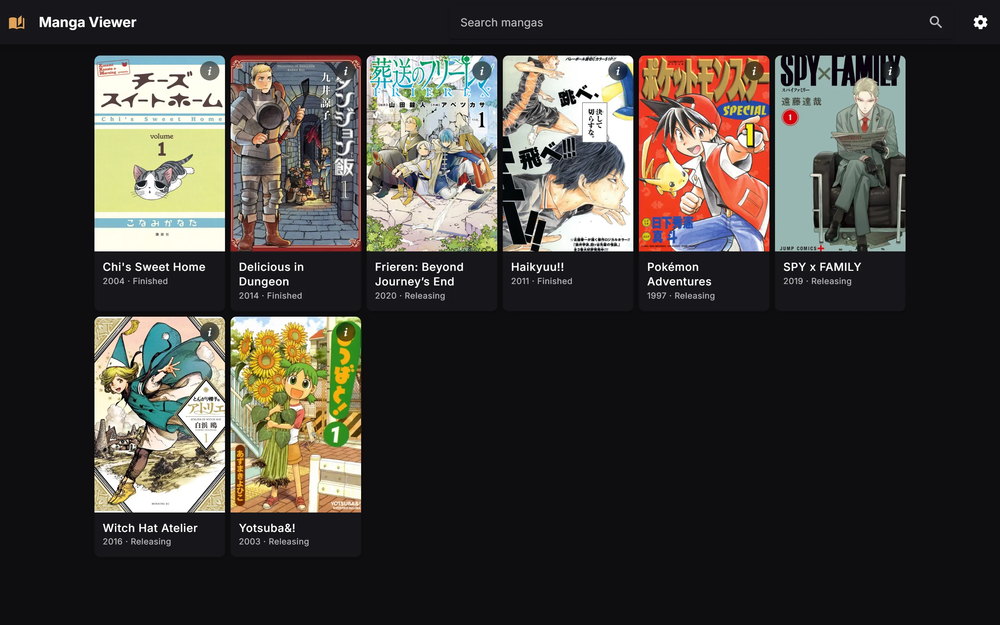
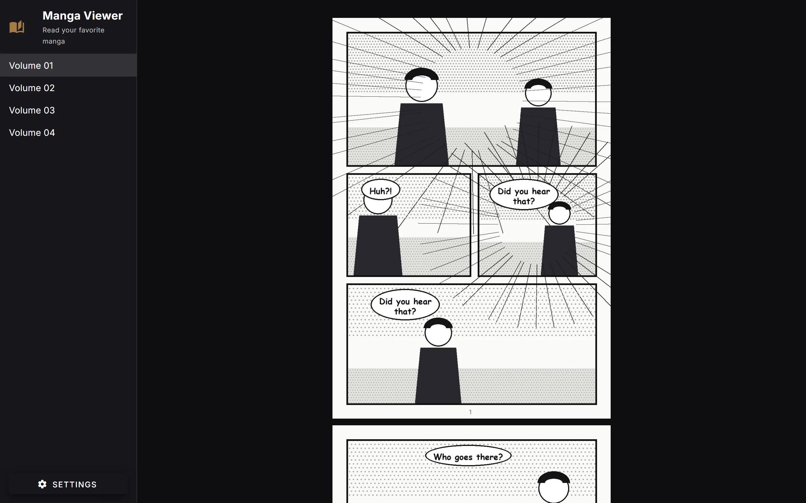
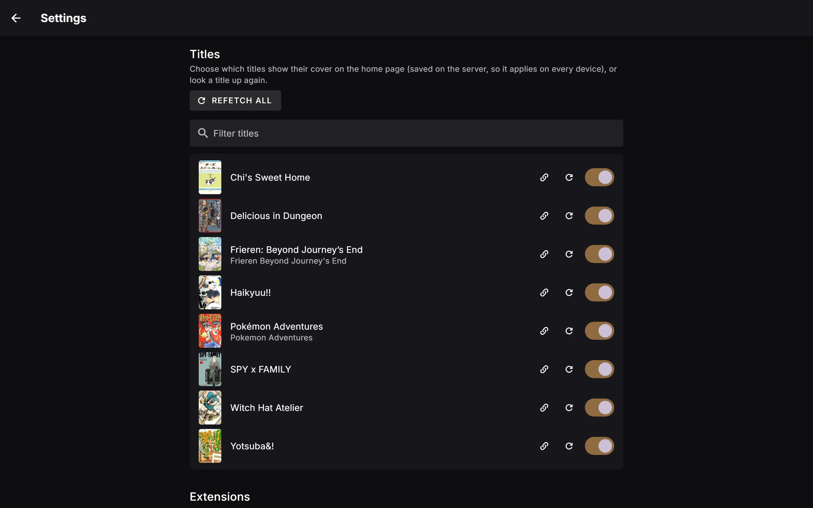
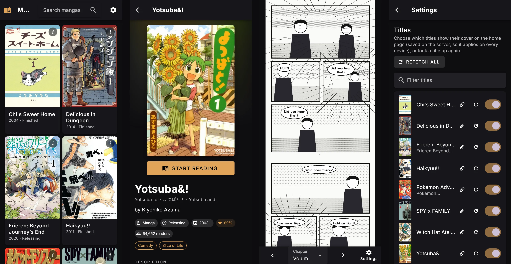

# MangaViewer

MangaViewer is a sleek and customizable manga reading web app for your local collection. Designed for PC and mobile,
it lets you comfortably enjoy your downloaded manga with features tailored for a smooth and flexible reading experience.

## Features ✨

-   [x] Adjustable image width and alignment (left, center, right)
-   [x] Image brightness control
-   [x] Adjustable spacing between images
-   [x] Bookmarking albeit not persistent (localStorage)
-   [x] Chapters as folders of images or as manga EPUB files

Please check the TODO if you wish to contribute

## Note

This project doesn't support downloading manga. It is primarily designed for reading manga that you
have already downloaded. I have manga downloading projects however, they haven't been maintained for a while.

## Getting Started 🚀

### Docker (recommended)

1. Clone the repository:

```bash
git clone https://github.com/Rishi-Bidani/mangaviewer.git
cd mangaviewer
```

2. Copy `.env.example` to `.env` and edit it:

```bash
PORT=8080                                    # port to open the site on
MANGA_DIR=/mnt/manga                         # folder containing one sub-folder per manga
IGNORE_LIST=kenja no mago,mangadownloader    # comma separated folders to hide
```

3. Start it with `docker compose up -d` (add `--build` to build the image yourself instead of
   pulling it) and open `http://<server-ip>:<PORT>`.

> [!NOTE]
> It's configured only through these environment variables (e.g. from a `.env` file, or the
> environment editor in Dockge or Portainer). The container log starts with every setting.
>
> `IGNORE_LIST` is split on commas, so a folder whose name contains a comma can't be ignored this
> way. Rename the folder, or move it out of `MANGA_DIR`.

### Standalone executable

Download the executable for your system from the
[releases page](https://github.com/Rishi-Bidani/mangaviewer/releases) (`mangaviewer-win-x64.exe`,
`mangaviewer-linux-x64`, `mangaviewer-darwin-arm64`, ...). It contains everything, Node.js included,
so nothing needs to be installed:

```bash
mangaviewer-win-x64.exe --dir "D:\manga" --port 8080 --ignore "kenja no mago,mangadownloader"
```

Without `--dir` it serves the folder it's started from, so you can also drop it into your manga
folder and double-click it. `--help` lists the options; the `BASE_MANGA_FOLDER`, `PORT`,
`IGNORE_LIST`, `FETCH_METADATA`, `METADATA_FOLDER`, `EXTENSIONS_FOLDER`, `ENABLED_EXTENSIONS` and
`ALLOWED_HOSTS` environment variables work too, also from a `.env` file next to the executable, but
flags win.

On Linux and macOS, make it executable first with `chmod +x mangaviewer-*`. macOS blocks downloaded
apps that aren't notarized: allow it under System Settings → Privacy & Security, or run
`xattr -d com.apple.quarantine mangaviewer-darwin-*`.

To build them yourself, run `pnpm bundle` with Node.js 25.7+; the executables for every platform
end up in `release/`. Executables for macOS are only signed when built on a Mac, and Apple Silicon
Macs won't run unsigned ones (sign them with `codesign --sign - <file>`).

### Without Docker

1. Install Node.js 24+ and pnpm 12 (`npm install -g pnpm@12`, or `corepack enable`), then run
   `pnpm install` in the repository root.
2. Copy `server/.env.example` to `server/.env` and edit it:

```bash
PORT=8080
BASE_MANGA_FOLDER=D:\manga
IGNORE_LIST=kenja no mago,mangadownloader
```

Environment variables with the same names override these, and the server refuses to start if a value
isn't valid. Restart it after changing the file. `IGNORE_LIST` is split on commas, so a folder whose
name contains a comma can't be ignored: rename it, or move it out of the manga folder.

If you open the site on a domain name, such as through a reverse proxy, add it to `ALLOWED_HOSTS`,
otherwise the API refuses it. IP addresses, names without a dot and `.local` names always work. This
stops other websites open in your browser from using the API.

At startup the server prints every setting and its value:

```
Settings:
   PORT                8099
   BASE_MANGA_FOLDER   D:\manga
   IGNORE_LIST         "kenja no mago", "mangadownloader"
   FETCH_METADATA      false
   METADATA_FOLDER     ...\server\data\metadata
   EXTENSIONS_FOLDER   ...\server\data\extensions
   ENABLED_EXTENSIONS  (none)
   ALLOWED_HOSTS       (none)
```

> [!NOTE]
> In development (`pnpm dev`, or the "Mangaviewer (dev)" launch config), the Vite dev server
> always forwards `/api` and `/images` to port 8080. If you change `PORT`, also change the two
> `target` URLs in `client/vite.config.ts`. Production builds and Docker aren't affected.

3. Run it, from the repository root:

| Command | What it does |
|---|---|
| `pnpm build` | Builds the client into `client/dist` and the server into `server/dist` |
| `pnpm start` | Runs the built app |
| `pnpm dev` | Runs the server and the Vite dev server with live reload |
| `pnpm bundle` | Builds the standalone executables into `release/` (needs Node.js 25.7+) |
| `pnpm lint` / `pnpm format` | Lints / formats both packages |

### Your manga folder

Every folder in the manga folder is a manga. Inside it, every folder of images is a chapter, and so
is every `.epub` file, named after the file without `.epub`:

```
manga/
  One Piece/
    Chapter 1/        001.jpg, 002.jpg, ...
    Volume 2.epub
```

EPUBs are read as manga: their pages are the images they show, in reading order. Text isn't shown,
so a novel EPUB has no pages. A folder hides an EPUB of the same name.

### Covers and details

The home page shows a cover for every manga. By default it's the first page of the first chapter,
or a `cover.jpg` / `.png` / `.webp` you put in the manga's folder. Covers can be turned off per
title on the settings page (the cog on the home page); that choice is saved in the server's database,
so it applies on every device.

Covers, titles, authors, genres and descriptions can also be looked up on
[AniList](https://anilist.co). This is **off by default** because it sends your manga folder names
to AniList. Turn it on with `FETCH_METADATA=true` in `server/.env` (or `.env` with Docker), or
`--metadata` (standalone executable).

- Each manga is looked up once, a few seconds apart, and the result is cached in `server/data/metadata`
  (Docker: the `metadata` volume; standalone: `.mangaviewer/metadata` in the manga folder). To look
  titles up again, use the refetch buttons on the settings page.
- The search uses the folder name without tags like `[Colored]` or `(2019)`. Names shorter than 5
  characters aren't looked up, since they match too many things.
- Wrong match, not found, or a short name? Use the 🔗 button on the settings page to search for the
  manga or paste its link or id (`anilist.co/manga/<id>`). It opens by itself when refetching a
  single title finds nothing.
- Or add a `metadata.json` to the manga's folder, which takes priority over the settings page. Any
  field other than `match` overrides what the source returned:

```json
{
    "match": { "source": "anilist", "id": "30013" },
    "title": "One Piece (Colored)"
}
```

### Where your data is kept

The metadata folder above holds `mangaviewer.db`, a SQLite database with the fetched details, your
preferences, sync progress and extension settings (which includes sign ins and API keys, as plain
text), next to the downloaded covers. Back up that folder to keep all of it; your manga folder is only
ever read, apart from the standalone executable keeping its `.mangaviewer` folder there.

To change the tables, edit `server/src/system/schema.ts` and run
`pnpm --filter @mangaviewer/server db:generate`. Commit what it adds to `server/drizzle`; existing
databases are updated when the server starts.

### Other metadata sources

AniList is the default source and MyAnimeList is built in too; pick one on the settings page. You
can add others, or write your own in TypeScript, with [extensions](docs/extensions.md). They're kept
in `EXTENSIONS_FOLDER` and only run once they're listed in `ENABLED_EXTENSIONS`.

### Syncing your progress

Reading a chapter to its end can update your MyAnimeList list and an Excel file with a row per manga,
in any combination; switch them on on the settings page. See
[syncing progress](docs/extensions.md#syncing-progress).

> [!WARNING]
> Extensions are ordinary code with full access to the server, so only run ones you trust.

## TODO

-   [ ] Add persistent bookmarks

## Screenshots 📸

Covers and details are looked up on AniList; the chapter pages are placeholders.



<p>
  
  
</p>



On a phone:



Feel free to fork, star ⭐, or contribute! Have ideas? Create an issue or PR!
